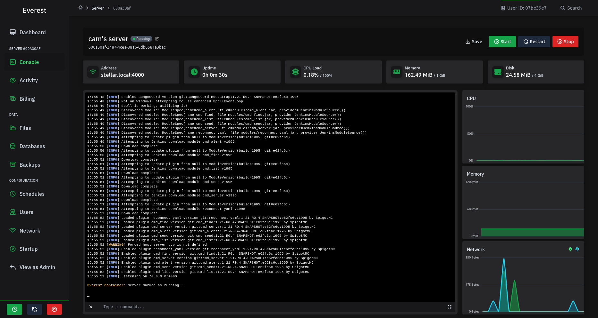
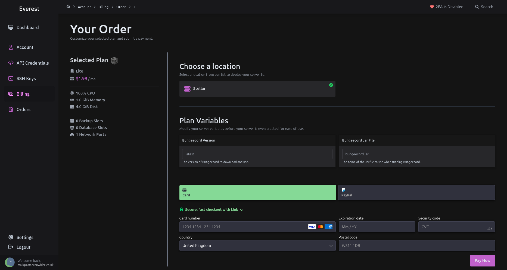
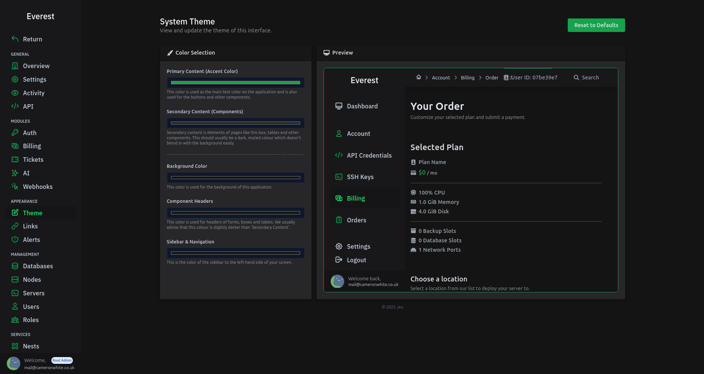
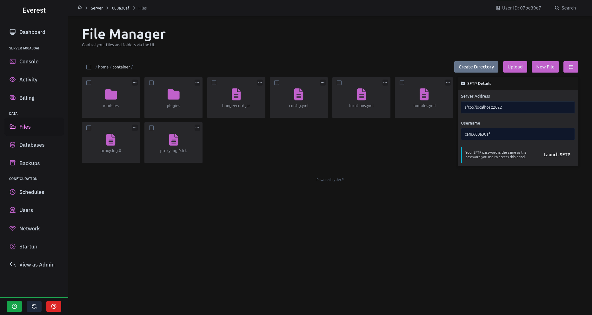
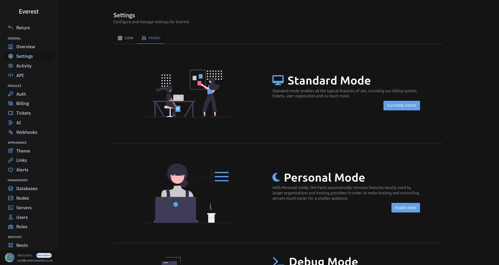

<div align="center">

# Jexpanel

**The game server panel with billing built in.**<br/>
Fast, secure and fully customisable. Built on Pterodactyl, formerly known as Jexactyl.

[](https://github.com/camwhi-te/jex/releases)
[](https://github.com/camwhi-te/jex/actions/workflows/ci.yaml)
[](https://github.com/camwhi-te/jex/actions/workflows/phpstan.yaml)
[](https://github.com/camwhi-te/jex/pkgs/container/jex)
[](LICENSE.md)
<br/>
[](https://github.com/camwhi-te/jex/stargazers)
[](https://github.com/camwhi-te/jex/network)
[](https://github.com/camwhi-te/jex/commits/develop)
[](https://discord.gg/qttGR4Z5Pk)

[Website](https://jexpanel.com) · [Documentation](https://docs.jexpanel.com) · [Releases](https://github.com/camwhi-te/jex/releases) · [Discord](https://discord.gg/qttGR4Z5Pk)

<br/>



</div>

---

## What is Jexpanel?

Jexpanel is a **game server management panel** for hosting providers, communities and anyone running servers for friends. It is built on [Pterodactyl](https://pterodactyl.io), so it works with the Wings daemon, eggs and nests you already use. On top of that it adds the parts you would otherwise wire up yourself: **billing, tickets, theming and a modernised UI**.

Customers can pick a plan, pay with Stripe or PayPal, and get their server deployed automatically. Admins manage everything (users, nodes, billing, branding) from one admin area, without editing code or rebuilding the frontend.

## ✨ Highlights

| | |
|---|---|
| 💳 **Built-in billing** | Sell server plans with **Stripe** and **PayPal**. Servers are created on payment and renewed every 30 days, so you need no separate WHMCS-style system. |
| 🆓 **Free packages** | Offer free plans alongside paid ones. Users can upgrade to a paid plan whenever they like. |
| 🎨 **On-the-fly theming** | Change accent, background, sidebar and component colours from the admin area, with a live preview. Nothing to recompile. |
| 🧭 **Panel modes** | **Standard** mode for hosting providers; **Personal** mode strips out billing and registration for small, private setups; **Debug** mode helps with troubleshooting. |
| 🔐 **Modern authentication** | Passkeys (WebAuthn), TOTP two-factor, and Discord / Google sign-in, configurable per install. |
| 🎫 **Tickets & alerts** | A built-in support ticket system and site-wide alert banners for maintenance or announcements. |
| 🤖 **AI assistant** | Optional Gemini-powered assistant, available right from the server console. |
| 🔔 **Webhooks** | Send panel events to a Discord channel, and choose which events to send. |
| 🛡️ **Roles & permissions** | Fine-grained admin roles, so staff only see what they need. |
| 🧩 **Extensible** | The UI is React + TypeScript + Tailwind, so it is straightforward to adapt to your brand. |

## 📸 Screenshots

<table>
  <tr>
    <td width="50%" valign="top">
      <a href=".github/assets/screenshots/console.png"></a>
      <p align="center"><b>Server console</b><br/><sub>Live console with CPU, memory and network graphs.</sub></p>
    </td>
    <td width="50%" valign="top">
      <a href=".github/assets/screenshots/billing.png"></a>
      <p align="center"><b>Billing checkout</b><br/><sub>Choose a plan, a location and server variables, then pay by card or PayPal.</sub></p>
    </td>
  </tr>
  <tr>
    <td width="50%" valign="top">
      <a href=".github/assets/screenshots/theme.png"></a>
      <p align="center"><b>Theme editor</b><br/><sub>Rebrand the panel instantly, with a live preview.</sub></p>
    </td>
    <td width="50%" valign="top">
      <a href=".github/assets/screenshots/files.png"></a>
      <p align="center"><b>File manager</b><br/><sub>Browse, upload and edit server files, with SFTP details alongside.</sub></p>
    </td>
  </tr>
  <tr>
    <td colspan="2" valign="top">
      <a href=".github/assets/screenshots/modes.png"></a>
      <p align="center"><b>Panel modes</b><br/><sub>Switch between Standard, Personal and Debug modes from the admin settings.</sub></p>
    </td>
  </tr>
</table>

## 🚀 Getting started

### One-line install

On a fresh server, run the installer as root:

```bash
curl -fsSL https://www.jexpanel.com/install.sh | bash
```

### Docker

Images are published to the GitHub Container Registry on every push to `develop`:

```bash
docker pull ghcr.io/camwhi-te/jex:latest
```

Use [`docker-compose.example.yml`](docker-compose.example.yml) as a starting point. It includes MariaDB and Redis.

For full requirements, manual installation, upgrading from Pterodactyl and configuration, see the **[documentation](https://docs.jexpanel.com)**.

## 🧱 Tech stack

<p>
  
  
  
  
  
  
  
</p>

## 🤝 Contributing

Contributions are welcome, whether they are bug reports, fixes or new features.

1. Read [`CONTRIBUTING.md`](CONTRIBUTING.md), including the policy on AI-assisted contributions.
2. Open an [issue](https://github.com/camwhi-te/jex/issues) or start a conversation on [Discord](https://discord.gg/qttGR4Z5Pk) before large changes.
3. Fork, branch from `develop`, and open a pull request.

Found a security issue? Please **don't** open a public issue. Follow the responsible disclosure steps in [`CONTRIBUTING.md`](CONTRIBUTING.md) instead.

## 💚 Support the project

If Jexpanel saves you time, consider [sponsoring development](https://github.com/sponsors/camwhi-te) or leaving a ⭐ on the repo.

## 📄 License

Jexpanel is open-source software licensed under the [MIT License](LICENSE.md). It is based on [Pterodactyl Panel](https://github.com/pterodactyl/panel), © Dane Everitt and contributors.
